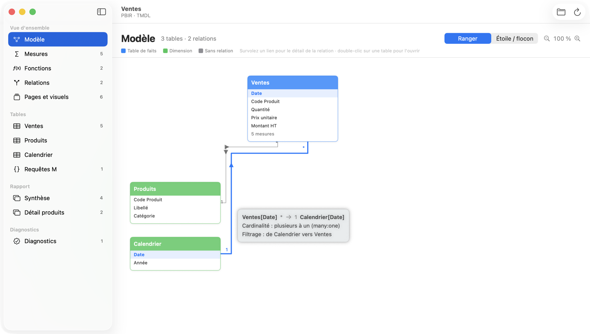
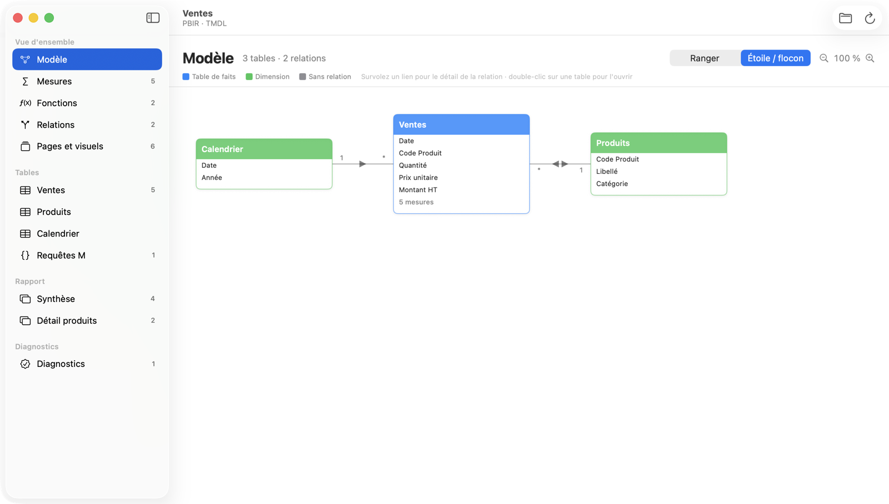
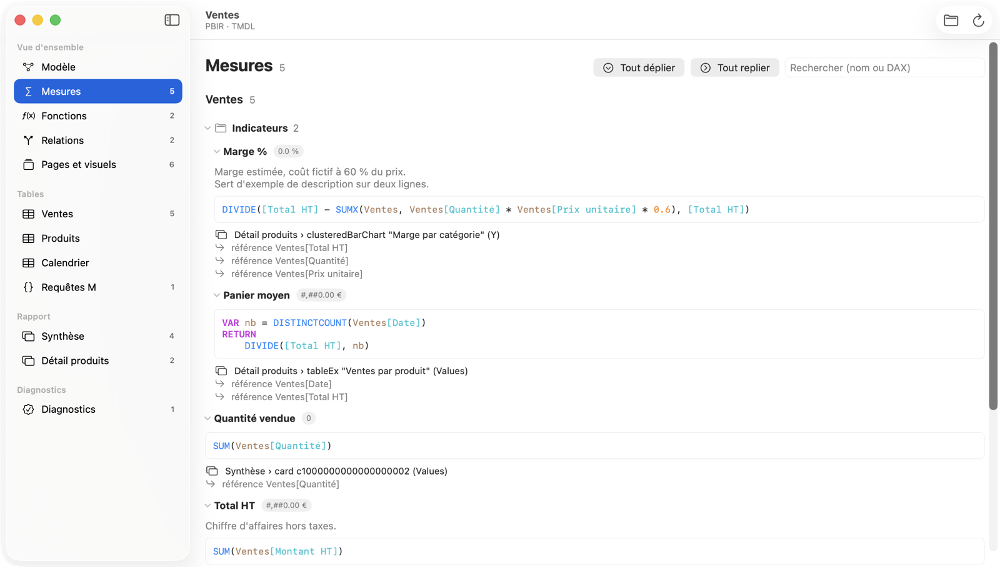
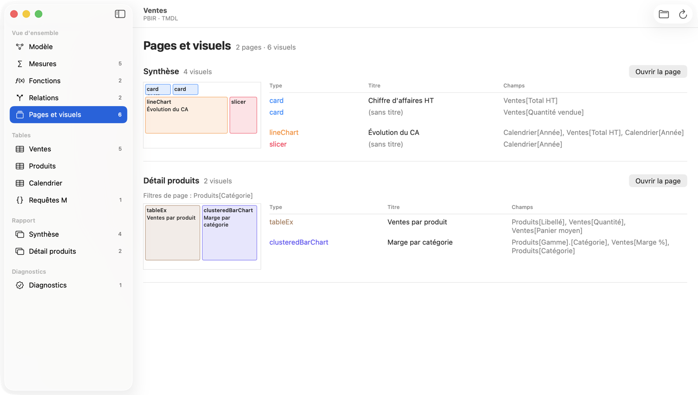
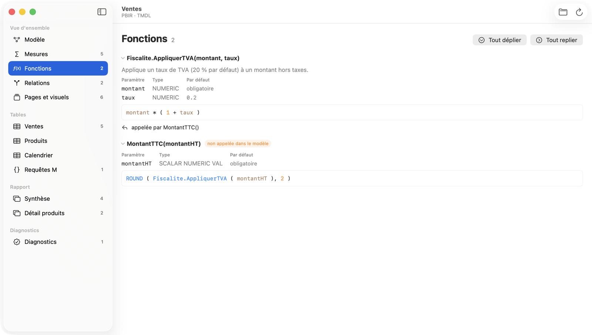

[Français](./) · **English**


## Read your PBIP projects on your Mac

Data model, DAX measures, relationships, pages and visuals: a whole PBIP project at a glance,
**without changing a thing**. A native app and a command-line tool, free and open source.

**[⬇ Download for macOS](https://github.com/florentinodsn/pbip-reader/releases/latest/download/PBIP-Reader.dmg)**
· [Install from source](#install-from-source)
· [Source code](https://github.com/florentinodsn/pbip-reader)

macOS 13 or later · Apple Silicon and Intel · MIT license



## Features

Open a `.pbip` file or a `.Report` / `.SemanticModel` folder: PBIR and PBIR-Legacy, TMDL and
`model.bim`.

- **Model diagram**: fact tables on top and dimensions on the left, or a star / snowflake layout.
  Hovering a link shows the relationship.
- **Measures and folders**: every measure by display folder, highlighted DAX, search, and where
  each one is used in the report.
- **DAX user-defined functions**: parameters, types, defaults, body and callers.
- **Relationships** filterable by table or column, with cardinality and filter direction.
- **Pages and visuals**: a sketch of every page from visual positions, and the fields behind each
  visual.
- **Read-only, with diagnostics**: no file is ever modified; broken references, unknown fields and
  unused measures are reported.

The app's interface is in French.

| | |
|---|---|
|  |  |
| “Star / snowflake” layout | Measures by display folder |
|  |  |
| Pages and visuals | DAX user-defined functions |

## Installation

The app needs no account and connects to nothing.

### Download the app (easiest)

1. **Download** [PBIP-Reader.dmg](https://github.com/florentinodsn/pbip-reader/releases/latest/download/PBIP-Reader.dmg).
2. **Open it** and drag “PBIP Reader” onto the Applications folder.
3. **Launch it** from Launchpad or Spotlight, then `⌘O` to open a project.

The app is signed and notarized by Apple. Every version is on the
[releases](https://github.com/florentinodsn/pbip-reader/releases) page.

### Install from source

Once, if Apple's developer tools are not installed:

```bash
xcode-select --install
```

Then, to put the app in the Applications folder:

```bash
git clone https://github.com/florentinodsn/pbip-reader.git
cd pbip-reader
Scripts/make-app.sh /Applications
```

To update: `git pull`, then the same last command.

## Command line

The same information as text, JSON or Markdown, plus a `validate` command built for CI.
To install, from the `pbip-reader` folder:

```bash
swift build -c release
sudo mkdir -p /usr/local/bin
sudo cp .build/release/pbip /usr/local/bin/
```

```bash
pbip info     MyReport.pbip    # formats, pages, visuals, tables, measures
pbip model    MyReport.pbip    # tables, columns, DAX, relationships, M, functions
pbip report   MyReport.pbip    # pages and visuals with their fields
pbip lineage  MyReport.pbip    # what uses what, both ways
pbip validate MyReport.pbip    # diagnostics, exit code 1 on errors
```

---

MIT license · [source code](https://github.com/florentinodsn/pbip-reader)

This project is neither affiliated with nor endorsed by Microsoft. Power BI is a trademark of
Microsoft Corporation.
